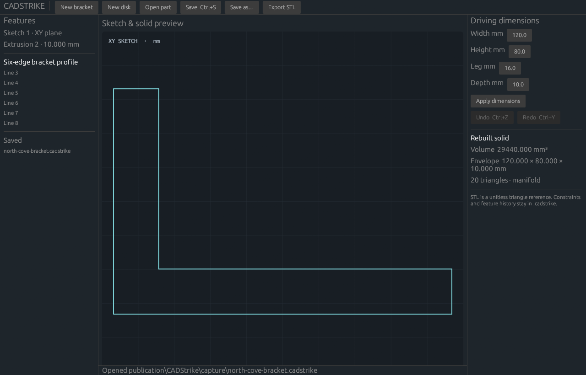

<p align="center">
  
</p>

<h1 align="center">CADStrike</h1>

<p align="center">
  <a href="https://prowebdevsolutions.com"><picture>
    <source media="(prefers-color-scheme: dark)" srcset="assets/branding/PWDS-logo-orange.svg">
    
  </picture></a>
</p>

**Give an idea its dimensions.**

## CADCraft drawing desktop

The CADStrike desktop based on ArtCraft's CADCraft is in [foundation](foundation/). It includes the imported editable 2D drawing engine, constraints, DXF/DWG file workflow and native editor, plus selected-file import of CADStrike bracket and disk sketches into a separate drawing. The original bracket editor remains available as a separate legacy workflow. [Migration details and limits](docs/CADCRAFT_FOUNDATION.md) explain the distinction and the pinned source.

### Build and start the CADCraft desktop on Windows

Install a Rust toolchain supporting edition 2024 and the Windows desktop prerequisites for eframe. From the repository root:

```powershell
.\scripts\Start-CADStrike.ps1 -PlanOnly   # inspect source and build selection; no build or launch
.\scripts\Start-CADStrike.ps1 -BuildOnly  # build the foundation desktop; no app launch
.\scripts\Start-CADStrike.ps1             # build as needed and start the foundation desktop
```

The launcher always selects `foundation/Cargo.toml`, package and binary `cadstrike`, and a separate `foundation/target` directory. It embeds the checkout's Git revision using the desktop's existing build-identity hook; modified checkouts are marked `-dirty`. To pass desktop arguments, use `-AppArguments @('--sample')`. Cargo must be available on `PATH`; dependencies must already be cached for offline operation.

On Windows the launcher requires successful icon/version-resource compilation with the installed Windows SDK resource compiler. It reports a build failure rather than starting an executable with missing Windows identity resources. Paths containing spaces and apostrophes, including the Room PC's user directory, are supported.

For manual Cargo use, select the foundation workspace explicitly:

```powershell
cargo run --locked --manifest-path foundation/Cargo.toml --package cadstrike --bin cadstrike --target-dir foundation/target
```

The launcher also supplies `CADCRAFT_BUILD_SHA` and requires `CADCRAFT_REQUIRE_WINRES=1`. A manual Cargo invocation needs those environment values for the same revision stamp and Windows-resource enforcement.

The root command `cargo run --features native-ui --bin cadstrike-ui` opens the legacy bracket editor. It does **not** open the CADCraft drawing desktop. A root `target/debug/cadstrike.exe` is the legacy CLI; the same executable name under `foundation/target/debug/` is the foundation desktop when built for the default host target. Select the workspace as well as the executable name.

## Verification status

The [foundation review workflow](.github/workflows/foundation-review.yml) tests the legacy converter, import UI and desktop, and builds the actual foundation binary. The launcher has lightweight selection tests that do not build or launch native code. A fresh source-matched native screenshot and pointer/keyboard review of the foundation desktop remain outstanding; the retained image below shows the legacy editor. Source presence and launcher tests do not establish runtime acceptance.

## Retained legacy bracket and disk editor

The original part workflow creates bracket or disk sketches with dimensions, stable feature IDs, undo, `.cadstrike` persistence and binary STL reference export. From the repository root:

```powershell
cargo test --locked --offline
cargo run --locked --offline --features native-ui --bin cadstrike-ui
```

Its CLI works without the native UI feature:

```powershell
cargo run --locked --offline --bin cadstrike -- new-bracket 80 50 10 6 bracket.cadstrike
cargo run --locked --offline --bin cadstrike -- info bracket.cadstrike
cargo run --locked --offline --bin cadstrike -- export-stl bracket.cadstrike bracket.stl
```

Remove `--offline` if required crates are not cached locally. Existing output files are not overwritten. Keep the editable project: STL carries triangles, not dimensions, stable IDs, or units; output coordinates use millimetres by convention.



*Legacy editor capture: a self-authored 120 × 80 × 16 mm bracket at 10 mm depth, shown as a 2D outline. [Screenshot provenance](docs/SCREENSHOT_PROVENANCE.md) records that bounded capture.*

## Scope and next steps

The root source package contains the original bounded part workflow. The separate `foundation/` workspace supplies the actual pinned CADCraft 2D drawing candidate with visible legacy sketch import. A unified editable CADStrike part workflow, general 3D parametric features, assemblies, STEP, B-rep solids and cross-platform acceptance remain open. Complete native pointer, keyboard, scaling and accessibility review before a release. See the [October 2026 source/build audit](docs/SOURCE_BUILD_PROVENANCE.md) for the current source evidence and its runtime limits.

The original root app source is first-party work and bundles no donor code, logo, model, or font. The separate [`foundation/`](foundation/) candidate includes pinned CADCraft source under its [attribution](foundation/ATTRIBUTION.md), [notice](foundation/NOTICE), and [redistribution notes](foundation/STRIKE-REDISTRIBUTION-NOTES.md). Third-party Rust dependencies are listed in the corresponding `Cargo.lock` files and retain their upstream licenses. No first-party license has been selected for the original root checkpoint.

## PWDS brand artwork

The company mark in this masthead is the existing [official PWDS logo](https://github.com/Gerbzz/PWDS-Website/blob/main/public/prowebdevsolutions-logo.png), with the [official orange display asset](https://prowebdevsolutions.com/images/prowebdevsolutions-logo-orange.svg) for dark backgrounds. Any app logo above it remains the original Strike suite artwork.
